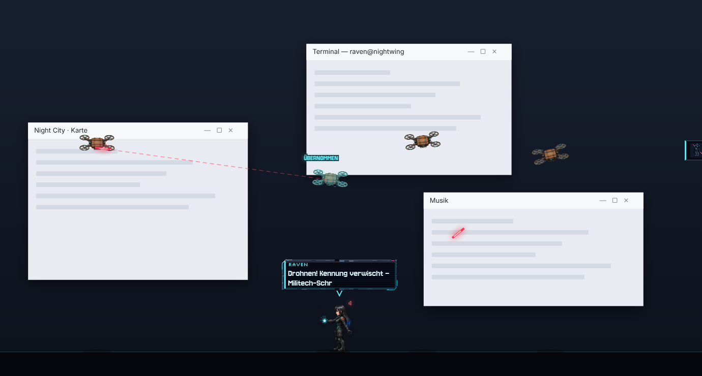
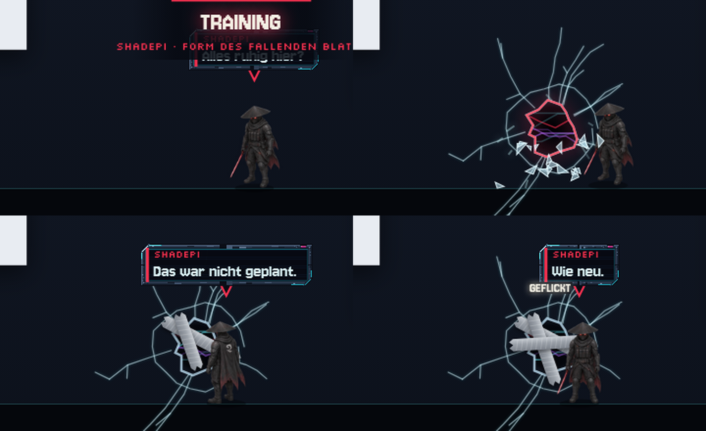
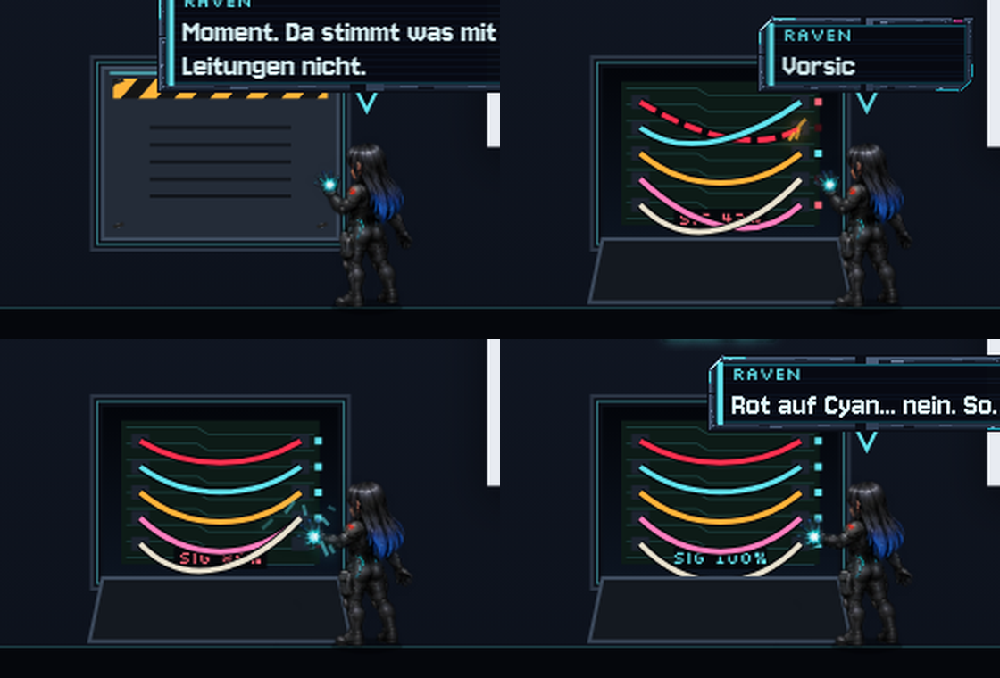
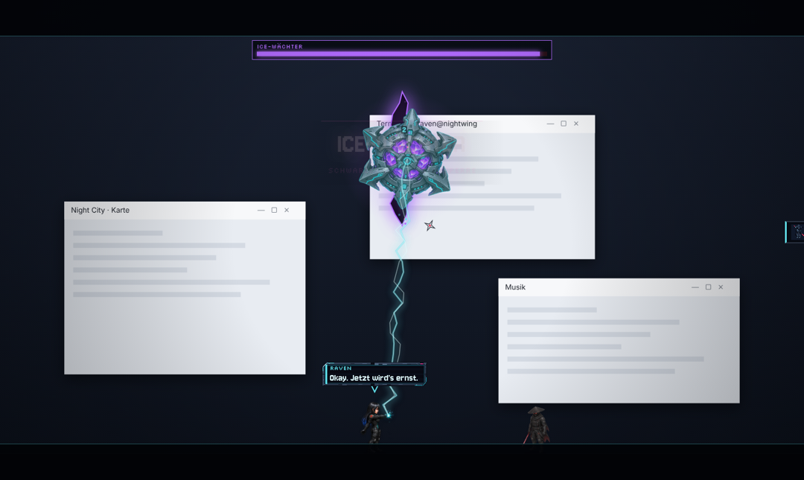
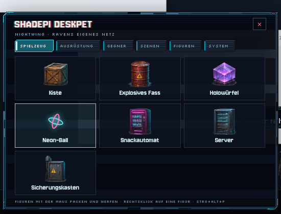

# Shadepi Deskpet

Ein Desktop-Maskottchen im Stil von **[ShadepiRPG](https://github.com/Inrouder/ShadepiRPG)**: **Shadepi** und **Raven** leben auf deinem Bildschirm. Sie laufen über die Taskleiste, klettern an echten Fenstern hoch, stehen auf Titelleisten und fahren mit, wenn du ein Fenster verschiebst. Ab und zu greifen Drohnen, Datenviren, Cyberpunk-Gangs, Kampfbots oder sogar Bosse an. Alles läuft vollautomatisch und mit Kino-Inszenierung: Letterbox-Balken, Titelkarten, Zeitlupe beim letzten Treffer, Kamerawackeln und Trefferstopps.



| Shadepi trainiert … und flickt das Loch mit Klebeband | Raven öffnet eine Wartungsluke und verkabelt neu |
| --- | --- |
|  |  |

| Boss: ICE-Wächter | Menü im Pixel-UI des Spiels |
| --- | --- |
|  |  |

## Was passiert auf dem Bildschirm?

- **Umschaltbar:** nur Shadepi, nur Raven, beide zusammen oder **abwechselnd** mit Schichtwechsel. In allen Einzelmodi kommt der Partner manchmal **zu Besuch** oder springt **im Kampf zur Hilfe** („Brauchst du Hilfe, Hutmann?“).
- **Fenster beklettern:** Raven schießt ihren Greifhaken an die Oberkante und zieht sich hoch, Shadepi läuft in Wandsprüngen an der Fensterkante hinauf – beides nur mit Originalposen aus dem Spiel. Liegen echte Kletterbilder vor (siehe unten), klettern beide richtig und ziehen sich über die Kante. Raven setzt sich gern an die Fensterkante oder legt sich hin, Shadepi hält Wache. Die Figuren erkennen unter Windows alle sichtbaren Fenster, klettern an den Seitenkanten hoch (Raven nutzt bei zu hohen Kanten ihren Greifhaken, Shadepi den Schattensprung), springen von Fenster zu Fenster und lassen sich wieder fallen. Verdeckte Teile werden berücksichtigt, die Ecke mit Minimieren/Schließen bleibt frei.
- **Kämpfe:** Drohnenpatrouillen und -schwärme, Virusausbrüche aus einem Glitch-Riss, Cyberpunk-Gangs und Schützen, Kampfbots im Luftabwurf, **Boss ICE-Wächter** und **Boss Chrome Jackal**. Manchmal kämpft eine Figur allein, manchmal beide zusammen.
  - **Shadepi:** Katana-Kombos, Tritt, aufgeladener Schlag, Sprungschlag gegen Flieger, Wurfsterne und der Spezialangriff **Schattenschnitt** (Zeitlupe + Nachbilder).
  - **Raven:** Impulspistole (auch aus der Hocke), Kettenblitz gegen Viren, **Drohnen-Hack** (die Drohne kämpft dann für sie), Störsignal gegen schwere Gegner.
  - **Doppelschlag:** Raven blockiert einen schweren Gegner, Shadepi vollendet.
  - Werden die Helden besiegt, gehen sie nur kurz in die Knie und regenerieren (Heiligtum bzw. Neustart).
- **Eigenleben:** Shadepi **trainiert** selbstständig, schlägt dabei manchmal versehentlich ein **Loch in den Bildschirm** und flickt es danach mit **Klebeband**. Raven öffnet ab und zu eine **Wartungsluke** im Bildschirm, scannt, löst die Schrauben und **verkabelt die Leitungen neu**, ARToS meldet „Signal 100 Prozent“. Dazu kommen Sparring (Shadepi pariert Ravens Schüsse), Gespräche zwischen den beiden, Ballspiel, Nickerchen und Kommentare zu deinen Fenstertiteln.

## Wecker, Timer und Erinnerungen

Im Menü unter **Wecker**:

- **Timer** mit Schnellwahl (1–60 Min, z. B. 25 Min für Pomodoro) oder frei einstellbar, optional mit Text („Pizza aus dem Ofen holen“).
- **Wecker** zu einer Uhrzeit – einmalig, täglich oder Mo–Fr.
- **Automatisch:** Pausen-Erinnerung (30–90 Min), Trink-Erinnerung und Stundenansage.

Wenn es so weit ist, kommen Shadepi und/oder Raven zu deinem Mauszeiger gelaufen. Raven projiziert ein Hologramm, Shadepi springt auf und ab, dazu Letterbox, Titelkarte und Alarmton. Eine Karte über den beiden bietet **Erledigt**, **+5 Min** und **+10 Min**. Ignorierst du sie, werden die beiden ungeduldig. Zusätzlich erscheint eine Windows-Benachrichtigung. Der nächste Countdown steht klein an der Seitenleiste.

## Spielmodus

Startest du ein Spiel, legt sich das Maskottchen komplett schlafen: Das Overlay verschwindet, nichts wird mehr gezeichnet, kein Ton, keine Ereignisse. Erst wenn das Spiel beendet ist, kommen die beiden zurück und fragen, wie es lief.

- Erkannt werden Spiele aus **Steam, Epic, GOG, Ubisoft, EA, Xbox, Rockstar, Riot, Amazon, itch.io**, aus Ordnern wie `D:\Games\…` sowie echte **Direct3D-Vollbild-Spiele**. Launcher wie Steam oder der Epic Launcher zählen nicht.
- Fehlt ein Spiel: Menü → System → Spielmodus → **„Als Spiel merken“** (zeigt die gerade offenen Programme). Wird etwas fälschlich erkannt: im Tray **„… ist kein Spiel“**.
- Timer und Wecker, die während des Spiels fällig werden, kommen als stille Windows-Benachrichtigung; der große Auftritt folgt nach dem Spiel. Pausen- und Trink-Erinnerungen ruhen.
- Im Tray: **„Trotzdem anzeigen“**, falls du sie doch beim Spielen dabeihaben willst.

## Updates

Die installierte Version (Setup) sucht beim Start und alle 6 Stunden nach einer neuen Version, lädt sie im Hintergrund und installiert sie beim nächsten Neustart. Raven meldet das Update und zeigt den Download-Fortschritt. Die portable EXE meldet neue Versionen und öffnet den Download. Manuell: Menü → System → „Nach Updates suchen“ oder im Tray-Menü.

Neue Versionen entstehen automatisch: Wird `version` in `package.json` erhöht und nach `main` gepusht, baut der Workflow das Programm und veröffentlicht es als GitHub-Release.

## Bedienung

| Aktion | Wirkung |
| --- | --- |
| Figur **mit der Maus packen** | Sie baumelt am Kragen und **schimpft**. Wer schüttelt, bekommt extra Ärger (und eine schwindelige Figur). |
| Figur **loslassen/werfen** | Sie fliegt, trudelt, landet und beschwert sich. Geworfene Figuren hauen Gegner um. |
| Figur **anklicken** | Sie reagiert und hüpft kurz. Wer zu oft klickt, erlebt eine Überraschung. |
| Fenster mit einer Figur darauf **ruckartig verschieben** | Sie fällt herunter und beschwert sich. |
| Gegner anklicken / packen / werfen | Du kannst mithelfen: Gegner gegeneinander werfen funktioniert. |
| Spielzeug anklicken | wird weggekickt; Power-ups lässt du von der nächsten Figur einsammeln. |
| **Rechtsklick auf eine Figur**, Klick auf das **Tray-Symbol**, die **Seitenleiste** rechts oder **Strg+Alt+P** | Menü öffnen. |
| **Strg+Alt+H** | Alles aus-/einblenden. |

Überall sonst gehen Klicks einfach durch das Overlay hindurch – du kannst normal weiterarbeiten.

### Menü

- **Spielzeug:** Kiste, explosives Fass, Holowürfel, Neon-Ball, Snackautomat, Server, Sicherungskasten (Grafiken aus dem Spiel). Die Figuren spielen damit: kicken, zerlegen Kisten, Raven hackt Automaten und schießt Fässer an.
- **Ausrüstung:** Heiligtums-Kern (Aura, doppelter Schaden), Drachenklinge (Schwertwellen), Wurfsterne, Overclock-Chip (Schnellfeuer), EMP-Granate, Nanitenpaket.
- **Gegner:** einzelne Drohnen, Viren, Cyberpunks, Schützen, Kampfbots sowie beide Bosse.
- **Szenen:** jedes automatische Ereignis lässt sich auch direkt starten.
- **Figuren:** Modus wählen, Partner rufen, Schichtwechsel.
- **System:** Größe, Lautstärke, Aktivität (Ruhig/Normal/Chaos), Kino-Effekte, Bildschirmschäden, Fensterklettern, Sprechblasen, Kampfmusik, bei Vollbild ausblenden, Ruhemodus, Beenden.

Einstellungen werden gespeichert. Über das Tray-Menü lässt sich außerdem **„Mit Windows starten“** und bei mehreren Monitoren der **Bildschirm** wählen.

## Installation (Windows)

1. Unter **Actions → Windows-Build** den neuesten erfolgreichen Lauf öffnen und das Artefakt **Shadepi-Deskpet-Windows** herunterladen (bei Versions-Tags `v*` liegt es zusätzlich unter **Releases**).
2. Entweder `Shadepi-Deskpet-…-portable.exe` direkt starten oder den Installer ausführen.
3. Windows SmartScreen kann beim ersten Start warnen, weil die Datei nicht signiert ist: „Weitere Informationen → Trotzdem ausführen“.

### Selbst bauen

```bash
npm install
npm start            # direkt starten
npm run dist         # Windows-Programm (portable + Installer) nach dist/
npm run demo         # Browser-Vorschau mit simulierten Fenstern: http://localhost:8377/?mode=beide
```

Nützliche Vorschau-Parameter: `?mode=beide&event=training`, `event=luke`, `event=ice`, `event=jackal`, `event=schwarm`, `activity=chaos`, `debug=1` (zeigt erkannte Kanten), `menu=1`.

## Technik

- **Electron**-Overlay: randlos, transparent, immer im Vordergrund, über den ganzen Bildschirm. Klick-Durchlass per `setIgnoreMouseEvents(…, { forward: true })`; nur über Figuren, Gegenständen und dem Menü fängt das Overlay die Maus ab.
- **Fenstererkennung** (`main/winscan.ps1`): ein kleiner PowerShell-/C#-Helfer liest per `EnumWindows` + DWM-Rahmen alle sichtbaren Fenster in Z-Reihenfolge (DPI-bewusst) und meldet Änderungen als JSON. Daraus berechnet `app/js/terrain.js` begehbare Oberkanten und kletterbare Seiten. Unter macOS/Linux laufen die Figuren nur auf dem Bildschirmboden.
- **Spiel-Engine** in reinem Canvas-JavaScript (`app/js/`): Helden-KI mit Generator-Abläufen (`hero.js`), Gegner (`enemies.js`), Spielzeug/Power-ups (`items.js`), Effekte und Bildschirmschäden (`fx.js`, `screen.js`), Kino-Regie (`cinema.js`) und die automatische Regie (`director.js`).

## Grafiken, Klänge und Schriften

Alles unter `app/assets/` stammt aus **ShadepiRPG** und wird dort nicht verändert: Helden-Atlanten, Kampfposen, Ravens Handzauber, Straßenkämpfer, Schützen, Chrome Jackal, Kampfbot, Drohne (Fahrzeugatlas), Datenvirus, ICE-Wächter, Requisiten, Feuer/Rauch/Explosion, Pixel-UI (Raven-Thema), Soundeffekte, Kampf-/Bossmusik und die Schriften *Shadepi Pixel* (Jersey 10, OFL) und *Silkscreen* (OFL). Neu übernehmen bzw. aktualisieren:

```bash
python tools/build_assets.py ../ShadepiRPG
```

Das Skript liest nur, schneidet Requisiten und FX aus den Atlanten, misst die Fußpunkte der Kampfposen und schreibt `app/assets/manifest.js`. Die Sprechblasen, Löcher, Klebeband, Wartungsluke, Projektile und kleinen Power-up-Symbole werden zur Laufzeit gezeichnet.

## Echte Kletterbilder ergänzen

Die Helden in ShadepiRPG sind gemalte Keyframes (`tools/hero_sources/*-keyframes.png`, Vorgaben in `prompts.json`). Für Klettern, Hochziehen und Sitzen auf der Kante braucht es neue Keyframes im selben Stil:

1. Mit demselben Bildwerkzeug wie die Spiel-Keyframes je Figur ein Blatt erzeugen – Vorgabe: `tools/climb_sources/prompts.json` (`raven` bzw. `shadepi`), als Referenz das jeweilige `*-keyframes.png` aus ShadepiRPG anhängen. Raster 1536×1024, 8×4 Zellen:
   Reihe 1 Klettern (Rückansicht, 8 Phasen) · Reihe 2 Hochziehen auf die Kante · Reihe 3 Sitzen auf der Kante · Reihe 4 Klettern im Profil (4 × Ost, 4 × West).
2. Speichern als `tools/climb_sources/raven-climb-keyframes.png` bzw. `shadepi-climb-keyframes.png`.
3. `python tools/compile_climb.py` – packt die Bilder wie `compile_heroes.py` (Originalfarben, 50 %, Fußlinie 152) nach `app/assets/heroes/`.
4. Versionsnummer erhöhen und pushen – das Update kommt automatisch an.

Sobald die Bilder da sind, nutzt das Spiel sie von selbst: echtes Klettern (Profil an Fensterseiten), Hochziehen exakt an der Fensterkante und Sitzen auf der Kante auch für Shadepi. Sitzen Hände oder Füße einzelner Bilder nicht genau, lassen sie sich in `tools/climb_sources/<held>-offsets.json` pixelgenau verschieben.
