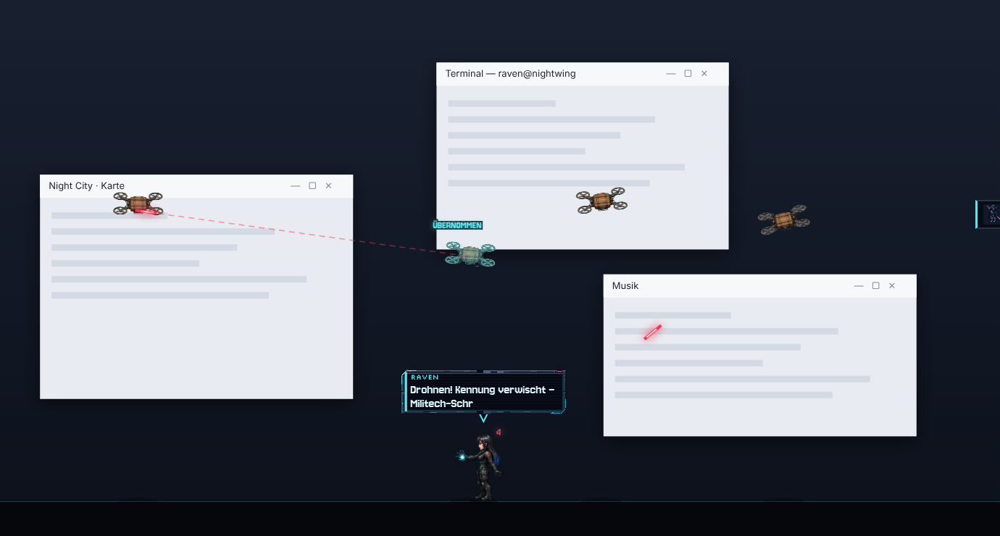
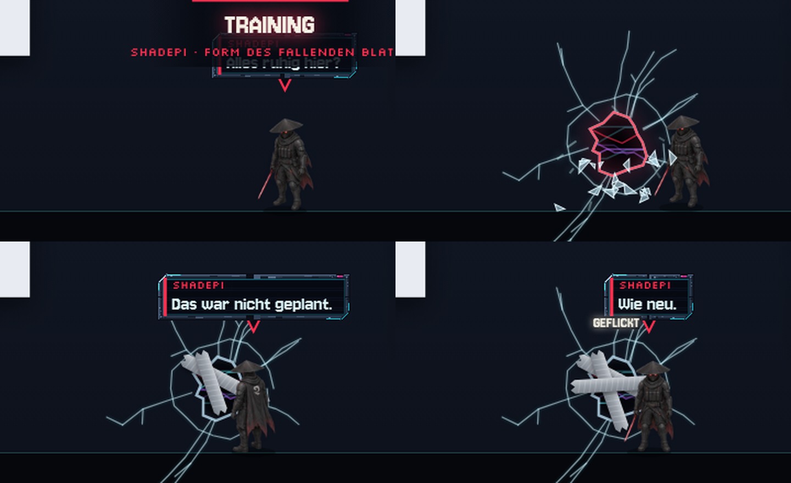
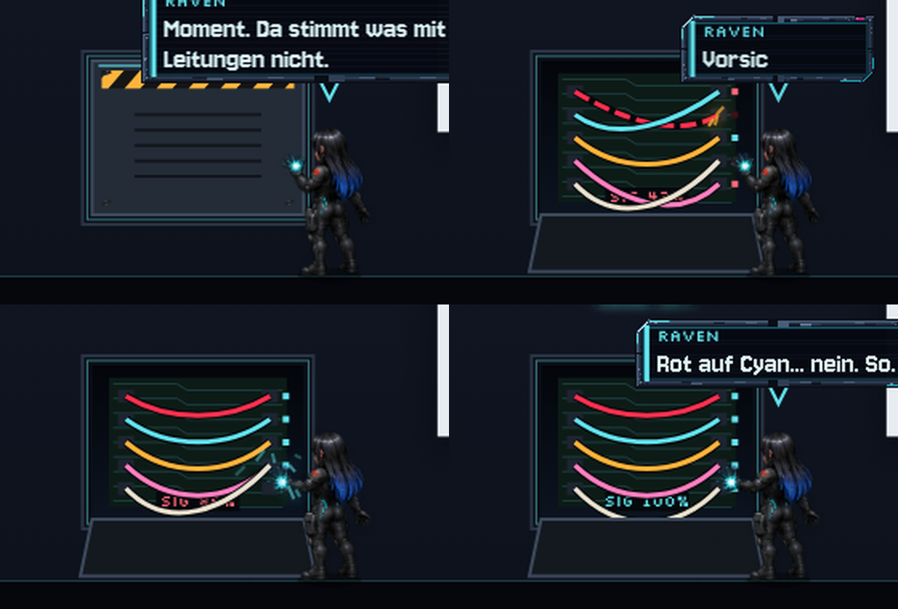
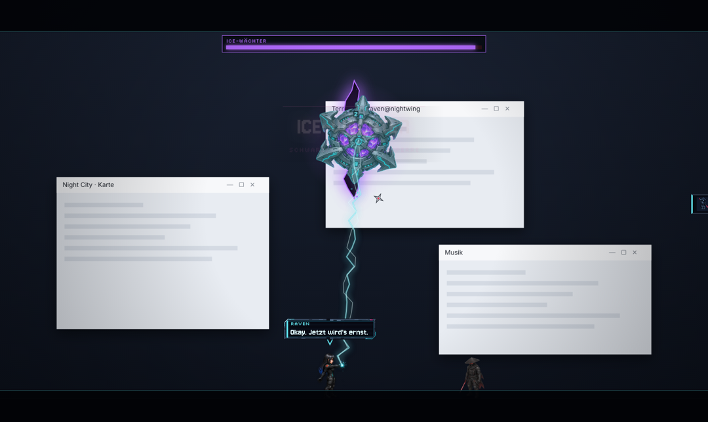
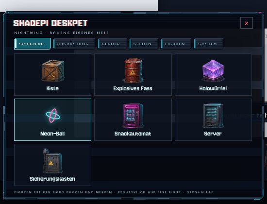

# Shadepi Deskpet

[](https://github.com/Inrouder/Shadepideskpet/releases/latest) [](https://github.com/Inrouder/Shadepideskpet/actions/workflows/build.yml)

Ein Desktop-Maskottchen im Stil von **[ShadepiRPG](https://github.com/Inrouder/ShadepiRPG)**: **Shadepi** und **Raven** leben auf deinem Bildschirm. Sie laufen über die Taskleiste, klettern an echten Fenstern hoch, stehen auf Titelleisten und fahren mit, wenn du ein Fenster verschiebst. Ab und zu greifen Drohnen, Datenviren, Cyberpunk-Gangs, Kampfbots oder sogar Bosse an. Alles läuft vollautomatisch und mit Kino-Inszenierung: Letterbox-Balken, Titelkarten, Zeitlupe beim letzten Treffer, Kamerawackeln und Trefferstopps.

<!-- neueste-version:start (wird beim Veröffentlichen automatisch aktualisiert) -->
> ### ⬇️ Neueste Version: [1.6.0](https://github.com/Inrouder/Shadepideskpet/releases/tag/v1.6.0) · 18.11.2026 · NEON KOMBAT
>
> **[Installer herunterladen](https://github.com/Inrouder/Shadepideskpet/releases/download/v1.6.0/Shadepi-Deskpet-1.6.0-Setup.exe)** (mit automatischen Updates) · **[Portable Version](https://github.com/Inrouder/Shadepideskpet/releases/download/v1.6.0/Shadepi-Deskpet-1.6.0-portable.exe)** (ohne Installation) · [alle Versionen](https://github.com/Inrouder/Shadepideskpet/releases) · [Änderungen](CHANGELOG.md)
>
> - **Dojo mit 13 Kämpfern:** neben den vier Ordensbrüdern jetzt auch Raven, Kenzō, Chrome Jackal, Punk Rot/Grün/Violett/Ocker und Wache Violett/Cyan – jeweils mit eigener Spezialtechnik (Hack-Impuls, Drachenhagel, Chromfaust, Violettplasma, Salve …).
> - **Shadepi kämpft im Dojo mit seinen neuen Arcade-Posen:** Block, Tritt, Spezialangriff, Siegerpose und liegender K.O.
> - **Neue Kämpferauswahl** mit großer, animierter Vorschau; Schwierigkeit per Q/Tab bzw. LB/RB.
> - **Desktop im NEON-KOMBAT-Stil:** Shadepi und Raven nehmen im Kampf die neuen Posen ein; Punks, Wachen und Jackal schlagen, treten, blocken, setzen Spezialtechniken ein und gehen richtig K.O.
> - **Begleiter:** Ravens Drohne schießt mit, Shadepis Nanitenschwarm kreist um ihn und sticht zu.
> - **Neues Ereignis:** Kenzō fordert Shadepi zum Sparring heraus.
> - Treffer- und EMP-Effekte aus dem neuen Effektblatt; Arcade-Stil und Begleiter lassen sich abschalten.
<!-- neueste-version:end -->



| Shadepi trainiert … und flickt das Loch mit Klebeband | Raven öffnet eine Wartungsluke und verkabelt neu |
| --- | --- |
|  |  |

| Boss: ICE-Wächter | Menü im Pixel-UI des Spiels |
| --- | --- |
|  |  |

## Was passiert auf dem Bildschirm?

- **Umschaltbar:** nur Shadepi, nur Raven, beide zusammen oder **abwechselnd** mit Schichtwechsel. In allen Einzelmodi kommt der Partner manchmal **zu Besuch** oder springt **im Kampf zur Hilfe** („Brauchst du Hilfe, Hutmann?“).
- **Fenster beklettern:** Raven schießt ihren Greifhaken an die Oberkante und zieht sich hoch, Shadepi läuft in Wandsprüngen an der Fensterkante hinauf – beides nur mit Originalposen aus dem Spiel. Liegen echte Kletterbilder vor (siehe unten), klettern beide richtig und ziehen sich über die Kante. Raven setzt sich gern an die Fensterkante oder legt sich hin, Shadepi hält Wache. Die Figuren erkennen unter Windows alle sichtbaren Fenster, klettern an den Seitenkanten hoch (Raven nutzt bei zu hohen Kanten ihren Greifhaken, Shadepi den Schattensprung), springen von Fenster zu Fenster und lassen sich wieder fallen. Verdeckte Teile werden berücksichtigt, die Ecke mit Minimieren/Schließen bleibt frei.
- **Kämpfe:** Drohnenpatrouillen und -schwärme, Virusausbrüche aus einem Glitch-Riss, Cyberpunk-Gangs und Schützen, Kampfbots im Luftabwurf, **Boss ICE-Wächter** und **Boss Chrome Jackal**. Manchmal kämpft eine Figur allein, manchmal beide zusammen.
  - **Shadepi:** Katana-Kombos, Tritt, aufgeladener Schlag, Sprungschlag gegen Flieger, Wurfsterne und der Spezialangriff **Schattenschnitt** (Zeitlupe + Nachbilder).
  - **Raven:** Impulspistole (auch aus der Hocke), Kettenblitz gegen Viren, **Drohnen-Hack** (die Drohne kämpft dann für sie), Störsignal gegen schwere Gegner.
  - **Doppelschlag:** Raven blockiert einen schweren Gegner, Shadepi vollendet.
  - Werden die Helden besiegt, gehen sie nur kurz in die Knie und regenerieren (Heiligtum bzw. Neustart).
  - **NEON-KOMBAT-Stil:** Sobald es zur Sache geht, kämpfen Shadepi und Raven mit den neuen Arcade-Posen aus ShadepiRPG (Kampfhaltung, Schlag, Tritt, Spezialtechnik, Block, Treffer, liegender K.O., Siegerpose). Punks, Wachen und Chrome Jackal haben dieselben 16-Posen-Blätter: Punk Rot mit Schlagserie, Punk Grün und Punk Violett schießen (Geschoss bzw. Violettplasma), Punk Ocker und Jackal schlagen mit Schockwelle auf den Boden, die Wachen feuern Salven, und alle können blocken. Treffer- und EMP-Effekte kommen aus dem neuen Effektblatt.
  - **Begleiter:** Ravens **Drohne** schwebt im Kampf hinter ihr und schießt mit, Shadepis **Nanitenschwarm** kreist um ihn und sticht in Gegner. Ab und zu zeigen die beiden ihre Begleiter auch einfach so vor.
  - **Kenzō fordert heraus:** Manchmal kommt Kenzō für ein Sparring mit Shadepi vorbei, blockt viel, verneigt sich am Ende und zieht weiter.
- **Mehrere Monitore:** Shadepi und Raven laufen über **alle Bildschirme**. Sie wechseln über die Taskleiste hinüber, fallen auf einen tieferen Nachbarboden oder springen (Schattensprung/Greifhaken) auf einen höheren, klettern dort an Fenstern hoch, und du kannst sie mit der Maus von einem Monitor auf den anderen ziehen. Szenen, Kämpfe, Erinnerungen und das Dojo spielen auf dem **Heimbildschirm** – wer gerade drüben ist, kommt per Schattensprung zurück. Läuft auf einem Monitor ein Vollbildprogramm, bleibt er frei.
- **Eigenleben:** Shadepi **trainiert** selbstständig, schlägt dabei manchmal versehentlich ein **Loch in den Bildschirm** und flickt es danach mit **Klebeband**. Raven öffnet ab und zu eine **Wartungsluke** im Bildschirm, scannt, löst die Schrauben und **verkabelt die Leitungen neu**, ARToS meldet „Signal 100 Prozent“. Dazu kommen Sparring (Shadepi pariert Ravens Schüsse), viele Gespräche zwischen den beiden (passend zu Tageszeit, gerade beendeten Kämpfen, deinem zuletzt gespielten Spiel oder den News), Ballspiel, Nickerchen und Kommentare zu deinen Fenstertiteln.

## Wecker, Timer und Erinnerungen

Im Menü unter **Wecker**:

- **Timer** mit Schnellwahl (1–60 Min, z. B. 25 Min für Pomodoro) oder frei einstellbar, optional mit Text („Pizza aus dem Ofen holen“).
- **Wecker** zu einer Uhrzeit – einmalig, täglich oder Mo–Fr.
- **Automatisch:** Pausen-Erinnerung (30–90 Min), Trink-Erinnerung und Stundenansage.

Wenn es so weit ist, kommen Shadepi und/oder Raven zu deinem Mauszeiger gelaufen. Raven projiziert ein Hologramm, Shadepi springt auf und ab, dazu Letterbox, Titelkarte und Alarmton. Eine Karte über den beiden bietet **Erledigt**, **+5 Min** und **+10 Min**. Ignorierst du sie, werden die beiden ungeduldig. Zusätzlich erscheint eine Windows-Benachrichtigung. Der nächste Countdown steht klein an der Seitenleiste.

## Ravens Systembericht

Ab und zu (und über Menü → Szenen → „Systembericht“) projiziert Raven ein Hologramm mit den echten Werten deines Rechners und kommentiert sie: **CPU-Auslastung und -Temperatur, GPU-Auslastung und -Temperatur, Arbeitsspeicher, Netzwerk-Datenrate (↓/↑) und Laufzeit**. Wird es kritisch, meldet sie sich von selbst: Prozessor über 88 °C, Grafikkarte über 85 °C, längere Volllast, fast voller Arbeitsspeicher oder ein großer Download.

- CPU-Last, RAM und Netzwerk kommen direkt von Windows.
- GPU: bei NVIDIA über `nvidia-smi` (Last + Temperatur), sonst die Auslastung über die Windows-Leistungsindikatoren.
- Temperaturen ohne Administratorrechte über die ACPI-Thermalzone (ungefährer Wert). **Genaue CPU-/GPU-Temperaturen** gibt es, wenn [LibreHardwareMonitor](https://github.com/LibreHardwareMonitor/LibreHardwareMonitor) im Hintergrund läuft – Raven liest es automatisch aus.
- Abschaltbar im Menü (System → „Systemberichte (Raven)“).

## Gaming-News

Shadepi ruft ab und zu ein rotes **Ordensnetz-Hologramm** auf und liest die neuesten Schlagzeilen vor – aus den RSS-Feeds großer Spieleseiten: auf Deutsch **Mein-MMO, PC Games, GameStar, GamePro, PCGH** und **Gamereactor**, auf Englisch **PC Gamer, IGN, Polygon, Kotaku, Rock Paper Shotgun** und **Eurogamer**. Die Meldungen landen in einer lokalen Datenbank (bis zu 400 Stück, zwei Wochen), alle 30 Minuten kommen neue dazu. Shadepi kommentiert jede Meldung passend zum Thema („Ein Patch. Klebeband für Spiele.“, „Kostenlos? Raven, hol das. Schnell.“), Raven mischt sich manchmal ein, und **„Artikel öffnen“** bringt dich direkt zum Artikel im Browser.

Im Menü unter **NEWS** stehen alle Meldungen: anklicken lässt Shadepi sie vorlesen, ↗ öffnet den Artikel. Dort wählst du auch Sprache (Deutsch, Englisch, beide), wie oft er vorliest, oder schaltest es ab. Während Spielen und Kämpfen bleibt er still.

## Zweisamkeit

Erscheint Shadepi, schaut Raven ihn oft an und es steigen kleine Herzen auf („Da ist er ja…“). Shadepi zeigt es auf seine Art: Mit einem Klingenhieb erschafft er eine **Kirschblüte aus Licht**, schenkt sie ihr, und Blütenblätter rieseln – danach dreht er sich verlegen weg. Abschaltbar unter System → „Romantische Momente“.

## Dojo: Kämpf selbst gegen Shadepi

Menü → Szenen → **Dojo**, im Tray **„Dojo: Gegen Shadepi kämpfen“** oder **Strg+Alt+D**. Du wählst einen von **13 Kämpfern** – seine vier **Ordensbrüder** oder einen der neun Kämpfer aus **NEON KOMBAT** (Raven, Kenzō, Chrome Jackal, vier Punks und zwei Wachen) – und eine Schwierigkeit. Alle kämpfen mit ihren echten Figuren aus ShadepiRPG; auch Shadepi selbst nutzt im Dojo seine Arcade-Posen. Die Auswahl zeigt den gewählten Kämpfer in Bewegung. Gekämpft wird auf dem Bildschirmboden, zwei Gewinnrunden, 75 Sekunden pro Runde.

| Ordensbruder | Waffe | Stärke | Spezialtechnik |
| --- | --- | --- | --- |
| **Oni** | Katana | ausgewogen, schnelle Kombos | **Oni-Wirbel** – drei Wirbelhiebe nach vorn und hinten |
| **Roboterkopf** | Kampfstab | größte Reichweite, zäh | **Stabsturm** – Sprung mit Bodenschlag-Schockwelle |
| **Ly** | weiße Lichtklinge | am schnellsten, wenig Leben | **Weißer Schatten** – Teleport hinter Shadepi, nicht blockbar |
| **MG-Krieger** | schweres MG | Fernkampf, Panzerung, Schulterstoß | **Sperrfeuer** – 14 Schuss am Stück |

| NEON KOMBAT | Waffe | Stärke | Spezialtechnik |
| --- | --- | --- | --- |
| **Raven** | Impulspistole & Hack | sehr schnell | **Hack-Impuls** – Datenstoß aus der offenen Hand |
| **Kenzō** | Fäuste | ausgewogen | **Drachenhagel** – drei Treffer im Vorstoß |
| **Chrome Jackal** | Chromfäuste | Panzerung, viel Leben | **Chromfaust** – Bodenschlag im Umkreis |
| **Punk Rot** | Schlagring | Kombos | **Schlagserie** – vier Treffer |
| **Punk Grün** | Revolver | Reichweite | **Geschoss** |
| **Punk Violett** | Plasmawerfer | größte Reichweite | **Violettplasma** – langsame, schwere Kugel |
| **Punk Ocker** | Keule | zäh | **Keulenhieb** – Bodenschlag |
| **Wache Violett / Cyan** | Gewehr | Fernkampf | **Salve** – fünf Schuss |

In der Auswahl: Pfeile/WASD wählen, **Q/Tab** (Controller LB/RB) wechselt die Schwierigkeit, Enter/A startet.

| Tastatur & Maus | Controller | |
| --- | --- | --- |
| A / D | Stick / Steuerkreuz | laufen |
| W / Leertaste | A | springen |
| Linksklick / J | X | Angriff |
| Rechtsklick / K | Y | schwerer Angriff |
| S halten | RB / RT | blocken – kurz vor dem Treffer: **Perfekte Parade** |
| Shift / L | B | ausweichen (kurz unverwundbar) |
| E | LB / LT | Spezialtechnik (bei voller Energie) |
| Esc | Start | Pause, Krieger wechseln, Dojo verlassen |

Shadepi nimmt es als **Training**: Er pariert, kontert mit Kombos, Tritt, aufgeladenem Hieb, Wurfsternen, Sprungschlag und auf „Schwer“ auch mit dem Schattenschritt; MG-Kugeln schlägt er gern zurück. Dabei kommentiert er – meist spöttisch („Du triffst die Luft. Sie hat Angst.“, „Du bist kein Frosch.“), manchmal mit Lob („Saubere Parade!“, „Der Orden wäre stolz.“). Auf „Leicht“ gibt er Tipps. Raven schaut zu und feuert an. Am Ende gibt es eine Wertung (S bis D) mit Treffern, bester Kombo und Paraden; Siege und Niederlagen werden gespeichert.

Während des Kampfes gehören Maus und Tastatur dem Dojo (der Desktop wird leicht abgedunkelt); danach geht alles wieder durch das Overlay hindurch. Startet ein Spiel, endet das Dojo automatisch. Fällige Wecker werden kurz eingeblendet und nach dem Kampf richtig gemeldet.

## Spielmodus

Startest du ein Spiel, legt sich das Maskottchen komplett schlafen: Das Overlay verschwindet, nichts wird mehr gezeichnet, kein Ton, keine Ereignisse. Erst wenn das Spiel beendet ist, kommen die beiden zurück und fragen, wie es lief.

- Erkannt werden Spiele aus **Steam, Epic, GOG, Ubisoft, EA, Xbox, Rockstar, Riot, Amazon, itch.io**, aus Ordnern wie `D:\Games\…` sowie echte **Direct3D-Vollbild-Spiele**. Launcher wie Steam oder der Epic Launcher zählen nicht.
- Fehlt ein Spiel: Menü → System → Spielmodus → **„Als Spiel merken“** (zeigt die gerade offenen Programme). Wird etwas fälschlich erkannt: im Tray **„… ist kein Spiel“**.
- Timer und Wecker, die während des Spiels fällig werden, kommen als stille Windows-Benachrichtigung; der große Auftritt folgt nach dem Spiel. Pausen- und Trink-Erinnerungen ruhen.
- Im Tray: **„Trotzdem anzeigen“**, falls du sie doch beim Spielen dabeihaben willst.

## Updates

Die installierte Version (Setup) sucht beim Start und alle 6 Stunden nach einer neuen Version, lädt sie im Hintergrund und installiert sie beim nächsten Neustart. Raven meldet das Update und zeigt den Download-Fortschritt. Die portable EXE meldet neue Versionen und öffnet den Download. Manuell: Menü → System → „Nach Updates suchen“ oder im Tray-Menü.

Neue Versionen entstehen automatisch: Wird `version` in `package.json` erhöht, ein passender Abschnitt in [`CHANGELOG.md`](CHANGELOG.md) ergänzt und nach `main` gepusht, baut der Workflow das Programm und veröffentlicht es als GitHub-Release. Der Abschnitt wird zum Release-Text, und der Kasten **„Neueste Version“** oben auf dieser Seite wird automatisch mit den neuen Download-Links aktualisiert (`tools/release-info.js`). Ohne Changelog-Abschnitt bricht der Build ab, damit keine Version ohne Beschreibung erscheint.

## Bedienung

| Aktion | Wirkung |
| --- | --- |
| Figur **mit der Maus packen** | Sie baumelt am Kragen und **schimpft**. Wer schüttelt, bekommt extra Ärger (und eine schwindelige Figur). |
| Figur **loslassen/werfen** | Sie fliegt, trudelt, landet und beschwert sich. Geworfene Figuren hauen Gegner um. |
| Figur **anklicken** | Sie reagiert und hüpft kurz. Wer zu oft klickt, erlebt eine Überraschung. |
| Fenster mit einer Figur darauf **ruckartig verschieben** | Sie fällt herunter und beschwert sich. |
| Gegner anklicken / packen / werfen | Du kannst mithelfen: Gegner gegeneinander werfen funktioniert. |
| Spielzeug anklicken | wird weggekickt; Power-ups lässt du von der nächsten Figur einsammeln. |
| **Rechtsklick auf eine Figur**, Klick auf das **Tray-Symbol**, die **Seitenleiste** rechts oder **Strg+Alt+P** | Menü öffnen. |
| Menü an der **Kopfzeile ziehen** | Menü wie ein Fenster verschieben – es bleibt dann dort und schließt nicht mehr von selbst. **Doppelklick** auf die Kopfzeile: wieder am Mauszeiger öffnen. |
| **Strg+Alt+H** | Alles aus-/einblenden. |
| **Strg+Alt+D** | Dojo öffnen (Kampf gegen Shadepi). |

Überall sonst gehen Klicks einfach durch das Overlay hindurch – du kannst normal weiterarbeiten.

### Menü

- **Spielzeug:** Kiste, explosives Fass, Holowürfel, Neon-Ball, Snackautomat, Server, Sicherungskasten (Grafiken aus dem Spiel). Die Figuren spielen damit: kicken, zerlegen Kisten, Raven hackt Automaten und schießt Fässer an.
- **Ausrüstung:** Heiligtums-Kern (Aura, doppelter Schaden), Drachenklinge (Schwertwellen), Wurfsterne, Overclock-Chip (Schnellfeuer), EMP-Granate, Nanitenpaket.
- **Gegner:** einzelne Drohnen, Viren, Cyberpunks, Schützen, Kampfbots sowie beide Bosse.
- **Szenen:** das **Dojo** und jedes automatische Ereignis lassen sich direkt starten.
- **Figuren:** Modus wählen, Partner rufen, Schichtwechsel.
- **System:** Arcade-Kampfstil und Begleiter (an/aus), Größe, Lautstärke, Aktivität (Ruhig/Normal/Chaos), Kino-Effekte, Bildschirmschäden, Fensterklettern, Sprechblasen, Kampfmusik, bei Vollbild ausblenden, Ruhemodus, Beenden.

Einstellungen werden gespeichert. **Autostart:** „Mit Windows starten“ gibt es im Menü unter System und im Tray; beim ersten Start fragt Shadepi (oder Raven) einmal nach. Startet das Programm mit Windows, begrüßen die beiden dich entsprechend. Bei mehreren Monitoren gibt es dort **„Auf allen Monitoren laufen“** (auch im Menü unter System) und die Wahl des **Heimbildschirms**.

## Installation (Windows)

1. Unter **Actions → Windows-Build** den neuesten erfolgreichen Lauf öffnen und das Artefakt **Shadepi-Deskpet-Windows** herunterladen (bei Versions-Tags `v*` liegt es zusätzlich unter **Releases**).
2. Entweder `Shadepi-Deskpet-…-portable.exe` direkt starten oder den Installer ausführen.
3. Windows SmartScreen kann beim ersten Start warnen, weil die Datei nicht signiert ist: „Weitere Informationen → Trotzdem ausführen“.

### Selbst bauen

```bash
npm install
npm start            # direkt starten
npm run dist         # Windows-Programm (portable + Installer) nach dist/
npm run demo         # Browser-Vorschau mit simulierten Fenstern: http://localhost:8377/?mode=beide
```

Nützliche Vorschau-Parameter: `?mode=beide&event=training`, `event=luke`, `event=ice`, `event=jackal`, `event=schwarm`, `activity=chaos`, `debug=1` (zeigt erkannte Kanten), `menu=1`.

## Technik

- **Electron**-Overlay: randlos, transparent, immer im Vordergrund, über den ganzen Bildschirm. Für jeden weiteren Monitor öffnet das Overlay per `window.open` ein eigenes Fenster mit passender Skalierung; die Welt bleibt eine einzige und wird in jedes Fenster mit dessen Versatz gezeichnet (`views.js`). Klick-Durchlass per `setIgnoreMouseEvents(…, { forward: true })`; nur über Figuren, Gegenständen und dem Menü fängt das Overlay die Maus ab.
- **Fenstererkennung** (`main/winscan.ps1`): ein kleiner PowerShell-/C#-Helfer liest per `EnumWindows` + DWM-Rahmen alle sichtbaren Fenster in Z-Reihenfolge (DPI-bewusst) und meldet Änderungen als JSON. Daraus berechnet `app/js/terrain.js` begehbare Oberkanten und kletterbare Seiten. Unter macOS/Linux laufen die Figuren nur auf dem Bildschirmboden.
- **Spiel-Engine** in reinem Canvas-JavaScript (`app/js/`): Helden-KI mit Generator-Abläufen (`hero.js`), Gegner (`enemies.js`), Spielzeug/Power-ups (`items.js`), Effekte und Bildschirmschäden (`fx.js`, `screen.js`), Kino-Regie (`cinema.js`), die automatische Regie (`director.js`) und der Dojo-Kampfmodus mit Controller-Unterstützung über die Gamepad-API (`duel.js`).

## Grafiken, Klänge und Schriften

Alles unter `app/assets/` stammt aus **ShadepiRPG** und wird dort nicht verändert: Helden-Atlanten, Kampfposen, Ravens Handzauber, Straßenkämpfer, Schützen, Chrome Jackal, Kampfbot, Drohne (Fahrzeugatlas), die vier Ordensbrüder Oni, Roboterkopf, Ly und MG-Krieger (Dojo), Datenvirus, ICE-Wächter, Requisiten, Feuer/Rauch/Explosion, Pixel-UI (Raven-Thema), Soundeffekte, Kampf-/Bossmusik und die Schriften *Shadepi Pixel* (Jersey 10, OFL) und *Silkscreen* (OFL). Neu übernehmen bzw. aktualisieren:

```bash
python tools/build_assets.py ../ShadepiRPG
```

Die NEON-KOMBAT-Kämpfer, Ravens Drohne, Shadepis Naniten, das Effektblatt und die Ordensbrüder kommen aus einem eigenen Schritt:

```bash
python tools/build_arcade.py ../ShadepiRPG
```

Das Skript liest nur, schneidet Requisiten und FX aus den Atlanten, misst die Fußpunkte der Kampfposen und schreibt `app/assets/manifest.js`. Die Sprechblasen, Löcher, Klebeband, Wartungsluke, Projektile und kleinen Power-up-Symbole werden zur Laufzeit gezeichnet.

## Echte Kletterbilder ergänzen

Die Helden in ShadepiRPG sind gemalte Keyframes (`tools/hero_sources/*-keyframes.png`, Vorgaben in `prompts.json`). Für Klettern, Hochziehen und Sitzen auf der Kante braucht es neue Keyframes im selben Stil:

1. Mit demselben Bildwerkzeug wie die Spiel-Keyframes je Figur ein Blatt erzeugen – Vorgabe: `tools/climb_sources/prompts.json` (`raven` bzw. `shadepi`), als Referenz das jeweilige `*-keyframes.png` aus ShadepiRPG anhängen. Raster 1536×1024, 8×4 Zellen:
   Reihe 1 Klettern (Rückansicht, 8 Phasen) · Reihe 2 Hochziehen auf die Kante · Reihe 3 Sitzen auf der Kante · Reihe 4 Klettern im Profil (4 × Ost, 4 × West).
2. Speichern als `tools/climb_sources/raven-climb-keyframes.png` bzw. `shadepi-climb-keyframes.png`.
3. `python tools/compile_climb.py` – packt die Bilder wie `compile_heroes.py` (Originalfarben, 50 %, Fußlinie 152) nach `app/assets/heroes/`.
4. Versionsnummer erhöhen und pushen – das Update kommt automatisch an.

Sobald die Bilder da sind, nutzt das Spiel sie von selbst: echtes Klettern (Profil an Fensterseiten), Hochziehen exakt an der Fensterkante und Sitzen auf der Kante auch für Shadepi. Sitzen Hände oder Füße einzelner Bilder nicht genau, lassen sie sich in `tools/climb_sources/<held>-offsets.json` pixelgenau verschieben.
